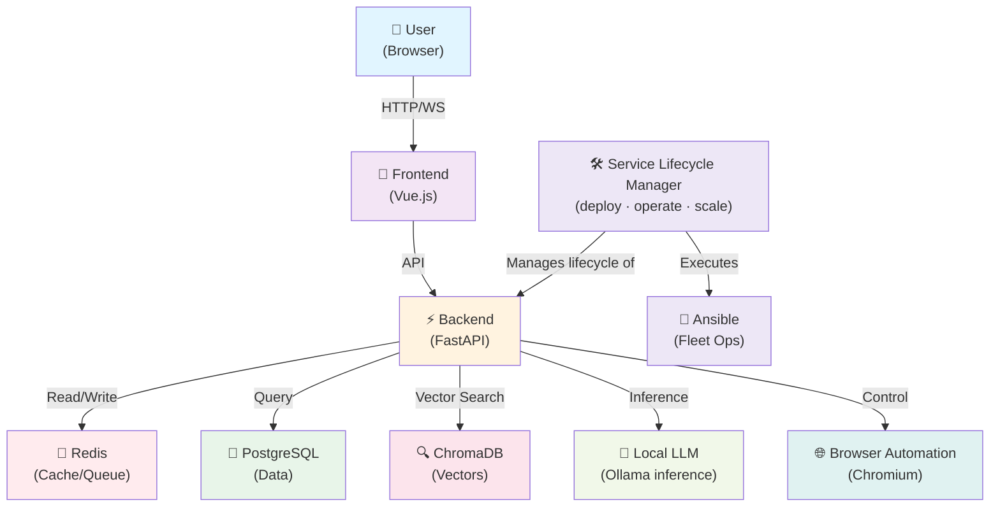

<div align="center">


# Your data. Your AI.

**AutoBot is a self-hosted AI platform you own — not a service you rent.**

Feed it your docs, your codebase, your business knowledge.
Plug in any LLM you trust — local or hosted.
Your data stays on your machines. Your AI stays yours.

[Get Started](#quick-start) · [Documentation](docs/) · [Community](https://github.com/mrveiss/AutoBot-AI/discussions) · [Sponsor](https://github.com/sponsors/mrveiss)

[](https://github.com/mrveiss/AutoBot-AI/actions/workflows/docker-smoke-test.yml)
[](https://codecov.io/gh/mrveiss/AutoBot-AI)
[](https://github.com/sponsors/mrveiss)
[](LICENSE)

</div>

---

> **AutoBot is infrastructure you own, not a subscription.**
> A small, solid core. A management layer that runs the hard infrastructure for you.
> Modules you install on top. Deploy it once, feed it your knowledge, connect whatever
> LLM you trust, and run it forever — on your terms.

| What you get | What stays yours |
|---|---|
| Chat interface | Your prompts |
| RAG knowledge base | Your documents |
| Service lifecycle management (SLM) | Your infrastructure |
| Modules (Company OS, Codebase Analytics, Transcriber) | Your data |

## Why, How, What

- **Why.** Private AI you trust with your business knowledge shouldn't require handing that
  knowledge — or control of the intelligence itself — to someone else's server.
- **How.** A small, stable Core (RAG + knowledge-graph memory, a provider-agnostic LLM gateway
  with fallback, governance) plus a management layer that absorbs deploy/operate/scale, plus
  Modules that inherit all of it instead of rebuilding it.
- **What.** A self-hosted AI platform — chat, a private knowledge base, a fleet-management
  dashboard, and installable modules. Apache-2.0. No subscription.

## The Platform Model

AutoBot is three layers, bottom to top:

1. **Platform Core** — small, solid, and yours. Chat and streaming, a RAG knowledge
   base backed by a knowledge graph (your *institutional memory*), an LLM gateway with
   provider fallback, local inference, hooks, and governance (auth, RBAC, review gates,
   budgets). It changes slowly so everything above can depend on it.
2. **Management Layer — Service Lifecycle Manager (SLM).** Private AI has a lot of
   moving infrastructure: vector DB, cache, database, inference, and background workers,
   often across several machines. The **Service Lifecycle Manager (SLM)** owns the full
   lifecycle — **deploy → operate → scale** — so you can run it in production without
   becoming a full-time operator. *(SLM means Service Lifecycle Manager, never "small
   language model.")*
3. **Modules** — installable capabilities built on the core's bones. A module inherits
   institutional memory, local inference at zero marginal cost, hooks, and governance,
   so it stays small relative to what it delivers. Modules include **Company OS** (an
   autonomous *agent-company*), **Codebase Analytics**, and the **Transcriber**.

→ Full picture: [The AutoBot Platform Model](docs/architecture/PLATFORM_MODEL.md)

## Quick Start

**Which path?** On a dedicated Ubuntu host, use the one-line installer (Option A). On
anything else, use Docker (Option B). Hardware and OS requirements are in one table:
[INSTALL.md#requirements](INSTALL.md#requirements).

**Option A — One-line installer (dedicated Ubuntu host).** Deploys the **Service Lifecycle
Manager (SLM) control plane** — Postgres, the SLM backend and nginx. The SLM then
provisions the platform onto your fleet nodes; it is not the platform itself:
```bash
curl -fsSL https://raw.githubusercontent.com/mrveiss/AutoBot-AI/main/install.sh | sudo bash
```
When it finishes, the installer prints your **SLM URL** (`https://<server>/slm/`) and the
`admin` password. Open that URL and log in — the **Setup Wizard** then walks you through
adding fleet nodes, enrolling agents, assigning roles, and provisioning. See
[First login](#first-login) for the main chat UI.

**Option B — Docker Compose (everyone else; quick eval / development).** A chat needs a
language model, and every model tier points at the bundled Ollama container, which only
starts with `--profile ollama`. Start it, then pull the default chat and embedding models
(the `AUTOBOT_DEFAULT_LLM_MODEL` and `AUTOBOT_EMBEDDING_MODEL` values in
`docker/.env.docker`):
```bash
git clone https://github.com/mrveiss/AutoBot-AI.git
cd AutoBot-AI
bash docker/generate-secrets.sh   # per-host secrets + a free network range
docker compose --env-file docker/.env.docker --env-file docker/.env.secrets --profile ollama up -d --build
docker compose --env-file docker/.env.docker --env-file docker/.env.secrets exec autobot-ollama ollama pull qwen3.5:9b
docker compose --env-file docker/.env.docker --env-file docker/.env.secrets exec autobot-ollama ollama pull nomic-embed-text:latest
```
User UI at **http://localhost**, SLM admin at **http://localhost/slm/**. Without
`--profile ollama` the stack starts but has no model to answer with.

`docker/.env.docker` also names smaller models for some other tiers (for example
`phi3:mini` and `mistral:7b-instruct`); pull those the same way if you use those tiers.
To use Anthropic instead of a local model, set `ANTHROPIC_API_KEY` in the environment
when you run `docker compose` (compose passes it to the backend). Provider settings live
in **SLM Admin > Settings > LLM** (`http://localhost/slm/`, then Settings, then the
**LLM** tab).

### First login

- **Docker:** log in to the main app at **http://localhost** as `admin`. The password is the
  `AUTOBOT_ADMIN_PASSWORD` line in `docker/.env.secrets` (generated per host; read it with
  `grep '^AUTOBOT_ADMIN_PASSWORD=' docker/.env.secrets`). The SLM admin is at
  **http://localhost/slm/**.
- **Native installer:** the printed login is for the SLM at `https://<server>/slm/`. The
  main app's admin account is seeded from `AUTOBOT_ADMIN_PASSWORD` in
  `/etc/autobot/slm-secrets.env`, or, when that line is absent, from `SLM_ADMIN_PASSWORD` in
  the same file -- the SLM admin password (the installer prints it when it generated it). The main app is served by the
  node you assign the frontend role to.
- Until onboarding is complete, the main app sends a newly logged-in user to its
  `/onboarding` page.

→ Full install options and the two-phase deployment flow: [INSTALL.md](INSTALL.md).

---

## What AutoBot Does

AutoBot is a **self-hosted AI platform**: conversational AI, a private knowledge base,
and the machinery to deploy and operate it all on your own hardware. You keep complete
control:

- **Unified Self-Hosted Dashboard** — manage AI, infrastructure, fleet operations, and
  analytics from one place on your servers
- **Natural Language Control** — issue commands in plain English; AutoBot handles the
  complexity locally
- **Self-Hosted Knowledge Bases** — build knowledge bases from your docs, code, runbooks,
  and workflows — RAG-indexed and stored locally
- **Vision Processing** — analyze screenshots and diagrams locally to guide decisions
- **Self-Hosted Fleet Management** — deploy, operate, and scale multi-server stacks with
  the Service Lifecycle Manager (SLM)
- **Installable Modules** — extend the platform with Company OS (an autonomous
  agent-company), Codebase Analytics, the Transcriber, and more
- **Complete Data Privacy** — full data control, no external dependencies, runs entirely
  on your hardware, no vendor lock-in
- **Governance-Ready Architecture** — audit logging, MFA, a secrets vault, retention
  policies, and RBAC, on an architecture (self-hosted data, a provider-agnostic LLM
  gateway, human-oversight-capable governance) designed to help with EU AI Act, NIS2 and
  data-protection obligations. The standards and regulations we are **working towards**,
  with their status and open work, are listed in
  [Compliance Targets](docs/compliance/COMPLIANCE_TARGETS.md); see also
  [EU AI Act, NIS2 & Governance Fit](docs/architecture/EU_AI_GOVERNANCE.md). No
  compliance or certification is claimed.

→ Browse everything in the [Capability Catalog](docs/features/CATALOG.md).

---

## System Requirements

Requirements (OS, RAM, disk, init system) are kept in one place, so they cannot drift:
see the table in [INSTALL.md#requirements](INSTALL.md#requirements).

---

## Platform Core: Features at a Glance

| Feature | Capability |
|---------|-----------|
| **Chat** | Multi-turn conversations with function calling, streaming responses |
| **Knowledge Bases** | RAG-powered retrieval from documents, code, infrastructure docs |
| **Knowledge Graph** | Institutional memory shared across sessions and modules |
| **LLM Gateway** | One place to plug in any model, with provider routing and fallback |
| **Workflow Builder** | Visual and code-based workflow creation |
| **Vision** | Image/screenshot analysis for troubleshooting |

## Management Layer: the Service Lifecycle Manager (SLM)

The **Service Lifecycle Manager (SLM)** is how AutoBot runs the infrastructure behind
private AI for you. It owns the full lifecycle of the stack — vector DB, cache, database,
inference, and workers — across one or more machines:

| Stage | What the SLM does |
|-------|-------------------|
| **Deploy** | Stand up the full stack from a blank host or across a fleet (Ansible) |
| **Operate** | Upgrades, health monitoring, recovery, certificate rotation, configuration |
| **Scale** | Add fleet nodes, add NPU workers, assign roles, provision new capacity |

The SLM dashboard lives at **http://localhost/slm/**. See
[SLM deployment](docs/guides/slm-docker-ansible-deployment.md).

## Modules

Modules are large capabilities you install on the core. Because they inherit the core's
institutional memory, local inference, hooks, and governance, they stay small relative to
what they deliver.

- **Company OS** — an autonomous *agent-company*: define a virtual company of AI agents
  (and human co-workers), give them goals and a backlog, schedule them to work
  autonomously, and govern their spend. See [Company OS](docs/llc/_index.md).
- **Codebase Analytics** — understand codebases, extract insights, and identify risks
  entirely on your own hardware: code structure analysis, risk detection, and dependency
  insights, with no source ever leaving your machines.
- **Transcriber** — a general-purpose audio transcription module: organize projects and
  recordings, transcribe locally, and export transcripts.

→ Browse all capabilities in the [Capability Catalog](docs/features/CATALOG.md).

---

## Why Self-Hosted

AutoBot keeps your AI and your data on infrastructure you control:

- **Data privacy** — your data never leaves your hardware, which helps you meet your own
  data-protection obligations ([what we are working towards](docs/compliance/COMPLIANCE_TARGETS.md))
- **Predictable cost** — local inference runs at zero marginal cost per request; no
  per-request fees
- **Full control** — run custom models, modify the code, no vendor lock-in
- **Low latency** — local inference and command execution, no network round-trip
- **Scale on your terms** — grow within your own infrastructure with the SLM

---

## Architecture Overview

> Full diagrams (data flows, deployment topologies, sequence diagrams): [docs/architecture/system-diagram.md](docs/architecture/system-diagram.md)  
> The conceptual model (core → SLM → modules): [docs/architecture/PLATFORM_MODEL.md](docs/architecture/PLATFORM_MODEL.md)  
> Feature walkthroughs and demo recording scripts: [docs/DEMOS.md](docs/DEMOS.md)



---

## Deployment Options

The one-line installer and Docker are described once, in [Quick Start](#quick-start).
Full details for both: [INSTALL.md](INSTALL.md).

### Development Mode
For contributing to AutoBot:
```bash
cp docker-compose.override.example.yml docker-compose.override.yml
docker compose --env-file docker/.env.docker --env-file docker/.env.secrets up -d --build
```

---

## Running AutoBot

- **Upgrade:** use the built-in updater in the SLM web UI: **Maintenance > Updates**, then
  the **Code Sync** tab. See the [Code Update runbook](docs/runbooks/CODE_UPDATE.md).
- **Backup, restore and disaster recovery:** [Disaster Recovery](docs/operations/disaster-recovery.md).
- **Hardened Docker deployment** (production overlay). `--profile ollama` starts the bundled
  model server the default provider settings point at; pull the models as in
  [Quick Start](#quick-start), or configure a hosted provider and drop the profile:
  ```bash
  docker compose -f docker-compose.yml -f docker-compose.hardened.yml --env-file docker/.env.docker --env-file docker/.env.secrets --profile ollama up -d
  ```
- **Uninstall and other installer options:** [INSTALL.md](INSTALL.md).

---

## Core Services

AutoBot runs as a coordinated set of services. Ports differ by install mode.

**Docker** (host ports from `docker-compose.yml`):

| Service | Role | Host port |
|---------|------|-----------|
| **Frontend** | Vue.js UI, serves `/api` and `/slm/` | 80, 443 |
| **Backend** | FastAPI API server | none published; reach it at `http://localhost/api` |
| **SLM** | Service Lifecycle Manager | none; at `http://localhost/slm/` |
| **Redis** | Cache, message queue | 6379 |
| **RedisInsight** | Redis UI | 127.0.0.1:8001 (this is **not** the backend) |
| **PostgreSQL** | Relational database | 127.0.0.1:5432 |
| **ChromaDB** | Vector embeddings store | 127.0.0.1:8100 |
| **Inference (Ollama)** | Local LLM inference | 127.0.0.1:11434 (profile `ollama`) |
| **Prometheus** | Metrics collection | 127.0.0.1:9090 (profile `monitoring`) |
| **Grafana** | Monitoring dashboards | 127.0.0.1:3000 (profile `monitoring`) |

**Native install:** nginx serves HTTPS on 443 and proxies the API at `/api`; the SLM is at
`https://<server>/slm/`. Per-service ports on the fleet nodes are set by the roles you assign.

**Health check:** Docker `curl http://localhost/api/system/health`; native
`curl -k https://<server>/api/system/health` (self-signed certificate).

---

## Usage Guide

### Dashboard Overview
Once running, navigate to **http://localhost** (Docker) or your main app node (native) to access:
- **Chat Interface** — start conversing with AutoBot about your knowledge and infrastructure
- **Knowledge Bases** — upload and manage documents, codebases, runbooks
- **Workflows** — create automated tasks and operations
- **Fleet Management** — view and orchestrate multiple servers
- **Analytics** — monitor system health, performance, and activity

The **Service Lifecycle Manager (SLM)** — AutoBot's management layer for deploying,
operating, and scaling your AI infrastructure (vector DB, cache, database, inference, and
workers) — lives at **http://localhost/slm/**.

### Example: Managing a Fleet
```bash
# In the AutoBot chat:
# "Deploy the latest application version to all production servers"
# AutoBot handles the Ansible orchestration automatically
```

### Example: Infrastructure Insights
```bash
# Ask AutoBot to analyze your codebase:
# "What are the critical dependencies in the auth module?"
```

---

## Configuration

Configuration is environment variables, read from these files (#18555):

- **Native install:** the installer writes each service's env file under `/etc/autobot/`; `.env.example` documents every option.
- **Docker:** `docker/.env.docker` plus the generated `docker/.env.secrets`, passed with `--env-file` (compose reads no root `.env` then).
- **Development tooling:** `.env.base` (shared keys) and one overlay, `.env.localhost`, `.env.native-vm` or `.env.network`, loaded in that order.

Key settings:
- `AUTOBOT_DEPLOYMENT_MODE` — `distributed` (default) or `standalone` (defined in `autobot_shared/env_registry.py`)
- `AUTOBOT_LLM_PROVIDER` — `ollama` (default) or others

### LLM Providers and Fallback

AutoBot's LLM gateway supports local and hosted providers (Ollama, OpenAI, Anthropic,
Groq, vLLM, HuggingFace, and OpenRouter). When a model hits a rate limit or quota cap,
requests automatically route to a backup model via configurable fallback chains.

- [LLM Fallback Configuration](docs/backend/llm-fallback.md) — configure fallback chains, tune rate limits, and troubleshoot quota issues
- [Environment Variables Reference](docs/configuration/environment-variables.md) — full variable listing including `AUTOBOT_FALLBACK_CHAIN_*` and `AUTOBOT_LLM_RL_*`

---

## Contributing

We welcome contributions! Whether you're fixing bugs, adding features, or improving documentation:

1. Check out [CONTRIBUTING.md](CONTRIBUTING.md) for guidelines
2. Look for issues tagged `good-first-issue` if you're new
3. Join the community discussion in [GitHub Discussions](https://github.com/mrveiss/AutoBot-AI/discussions)

---

## Support

- 💬 **Questions?** Start a discussion in [GitHub Discussions](https://github.com/mrveiss/AutoBot-AI/discussions)
- 🐛 **Found a bug?** Open an [issue](https://github.com/mrveiss/AutoBot-AI/issues)
- 💡 **Have an idea?** Share it in [Discussions → Ideas](https://github.com/mrveiss/AutoBot-AI/discussions/categories/ideas)

---

## How to Contribute

AutoBot is open source and we welcome contributions from the community! Whether you're fixing bugs, adding features, or improving documentation, your contributions help build a better self-hosted AI platform for everyone.

### 🚀 For Beginners (New to Open Source)

Start with [**good-first-issue** labeled tasks](https://github.com/mrveiss/AutoBot-AI/issues?q=is%3Aissue+is%3Aopen+label%3Agood-first-issue). These are:
- Self-contained and beginner-friendly
- Expected to take less than 2 hours
- Perfect for learning the codebase
- Great introduction to our contribution process

### 💻 For Experienced Developers

Find issues matching your skill area:

- **🎨 Frontend** (Vue.js, TypeScript, CSS, Vite)
  - [Help Wanted: Frontend](https://github.com/mrveiss/AutoBot-AI/issues?q=is%3Aissue+is%3Aopen+label%3Afrontend+label%3Ahelp-wanted)
  - [All Frontend Issues](https://github.com/mrveiss/AutoBot-AI/issues?q=is%3Aissue+is%3Aopen+label%3Afrontend)

- **🔧 Backend** (FastAPI, Python, APIs, Databases)
  - [Help Wanted: Backend](https://github.com/mrveiss/AutoBot-AI/issues?q=is%3Aissue+is%3Aopen+label%3Abackend+label%3Ahelp-wanted)
  - [All Backend Issues](https://github.com/mrveiss/AutoBot-AI/issues?q=is%3Aissue+is%3Aopen+label%3Abackend)

- **🚀 Infrastructure & DevOps** (Docker, Ansible, CI/CD, Deployment)
  - [Help Wanted: Infrastructure](https://github.com/mrveiss/AutoBot-AI/issues?q=is%3Aissue+is%3Aopen+label%3Ainfrastructure+label%3Ahelp-wanted)
  - [All Infrastructure Issues](https://github.com/mrveiss/AutoBot-AI/issues?q=is%3Aissue+is%3Aopen+label%3Ainfrastructure)

- **📚 Documentation** (Guides, Examples, README, API Docs)
  - [Help Wanted: Docs](https://github.com/mrveiss/AutoBot-AI/issues?q=is%3Aissue+is%3Aopen+label%3Adocs+label%3Ahelp-wanted)
  - [All Docs Issues](https://github.com/mrveiss/AutoBot-AI/issues?q=is%3Aissue+is%3Aopen+label%3Adocs)

- **🧪 Testing & QA** (Unit Tests, Integration Tests, Test Coverage)
  - [Help Wanted: Testing](https://github.com/mrveiss/AutoBot-AI/issues?q=is%3Aissue+is%3Aopen+label%3Atesting+label%3Ahelp-wanted)
  - [All Testing Issues](https://github.com/mrveiss/AutoBot-AI/issues?q=is%3Aissue+is%3Aopen+label%3Atesting)

### 📖 Step-by-Step Contribution Guide

Detailed contribution process, code style guidelines, and development setup:
→ **[Read CONTRIBUTORS.md](CONTRIBUTORS.md)**

---

## Sponsors & Supporters

Support AutoBot's development in multiple ways:

### Sponsorship & Donations
- **[GitHub Sponsors](https://github.com/sponsors/mrveiss)** — Recurring sponsorship with direct support and updates
- **[Ko-fi](https://ko-fi.com/mrveiss)** — One-time or recurring donations for maintenance and features

Your support helps us:
- Maintain and improve the codebase
- Add new features and capabilities
- Expand documentation and examples
- Grow the community
- Enable contributors to participate

---

## License

AutoBot is open source under the **[Apache License 2.0](LICENSE)**. Free forever for
everyone — use it, modify it, distribute it, and profit from it, no permission or fees
required. Attribution is required (see [NOTICE](NOTICE)), and the "AutoBot" / "mrveiss"
names may not be used to endorse derived products without permission.

**Free forever for individuals and hobbyists.** Nothing you can do with AutoBot today
becomes paid tomorrow. Production support is how we keep it funded — see
[FUNDING.md](FUNDING.md).

## Production support & funding

<!-- Tier copy is canonical in FUNDING.md (#9846) — do not restate tier definitions here. -->
AutoBot is free to run forever. Paid production support (Community / Production Support /
Compliance Pack) is how the project stays funded — tier definitions, sponsorship links, and
the support contact path live in **[FUNDING.md](FUNDING.md)**.

---

## Roadmap

### Shipped
- [x] Multi-user authentication and RBAC (there is one user mode; single-user mode is retired)

### Upcoming
- [ ] Kubernetes orchestration support
- [ ] Advanced analytics dashboards
- [ ] Module registry for discovering and installing third-party modules (the three modules above ship with the platform; no registry exists yet)
- [ ] Mobile companion app

### Under Consideration
- Cloud deployment templates
- Managed hosting option
- Enterprise features (SAML)

---

## Technology Stack

- **Frontend**: Vue.js, TypeScript, Vite
- **Backend**: FastAPI, Python, AsyncIO
- **Database**: PostgreSQL, Redis, ChromaDB
- **Inference**: Ollama (local), LangChain
- **Orchestration**: Ansible, Docker, Kubernetes (coming)
- **Infrastructure**: Docker Compose, systemd

---

## Documentation

- [Documentation Index](docs/INDEX.md) — the full documentation home
- [The AutoBot Platform Model](docs/architecture/PLATFORM_MODEL.md) — core → SLM → modules
- [Capability Catalog](docs/features/CATALOG.md) — everything AutoBot can do
- [INSTALL.md](INSTALL.md) — detailed setup instructions
- [CONTRIBUTING.md](CONTRIBUTING.md) — get involved

---

## Status

**Current version**: see the [GitHub Releases](https://github.com/mrveiss/AutoBot-AI/releases) page and the [CHANGELOG](CHANGELOG.md) (Active Development)

AutoBot is actively developed and used for self-hosted AI.
It's suitable for:
- ✅ Self-hosted deployments on your infrastructure
- ✅ Development and testing environments
- ✅ Learning AI-driven automation
- 🚀 Production use (with monitoring and backups)

---

**Made with ❤️ by the AutoBot community**
